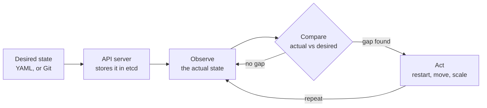

# What Kubernetes and OpenShift actually solve, and where they stop

> **Core engineering series · CE-001.** A living article, extended as new findings come in.

## Introduction

Kubernetes and OpenShift replace hand-run servers with a platform that keeps applications in the state you declare. That one change removes most of the routine work of operations: restarting crashed services, failing over dead servers, adding capacity for a peak, and releasing without downtime.

It does not remove the need for engineering. The platform introduces its own failure modes, and it leaves data, application design and operational discipline exactly where they were.

This article explains what the platform solves, how each mechanism actually works, and where each one stops. It is written for two readers at once. Every section opens with a plain-words summary for anyone new to the subject, followed by the engineering detail that an operator needs during an incident.

## The one idea: desired state and control loops

Every feature of Kubernetes follows from one design choice: you declare what should exist, and software keeps reality matching it, continuously.

**In plain words.** Picture a restaurant chain. In the old way, each branch is run by hand: a sick cook means phone calls for a replacement, and a busy evening means a queue. Kubernetes is a head office that never sleeps. You don't tell it how to run each kitchen. You tell it what you want, such as "always three cooks making pizza, from this exact recipe", and it checks every few seconds that this is still true.

| In the restaurant | In Kubernetes / OpenShift |
| --- | --- |
| The written instruction: "three pizza cooks, this recipe" | Desired state, written as YAML |
| Head office's order book, the single record of what should exist | etcd |
| The front desk that takes every request | API server |
| Supervisors who keep checking "do we have three cooks?" | Controllers |
| The person who decides which kitchen has room | Scheduler |
| The shift lead in each kitchen | kubelet |
| A kitchen | Node (a server) |
| A cook at work | Pod (one running copy of an app) |
| The sealed meal kit every cook starts from | Container image |
| The restaurant's phone number, whoever answers | Service |
| The sign on the street that brings customers in | Route or Ingress |
| A franchise owner's locked section, with its own budget | Namespace or Project |
| The storeroom that stays when a cook leaves | Persistent volume |

OpenShift is Kubernetes plus a franchise package: security rules on by default, a contractor that renovates every kitchen the same way, and built-in services for building and storing images.

**The engineering.** Each controller runs the same loop: observe the actual state, compare it with the desired state stored in etcd, act to close the gap, and repeat.



The loop never ends: when actual and desired match, the controller does nothing and checks again. Different controllers watch different things.

| Controller | Watches | Acts when actual differs from desired |
| --- | --- | --- |
| ReplicaSet controller | Number of matching pods | Creates or deletes pods |
| Deployment controller | The pod template | Creates a new ReplicaSet and shifts pods to it |
| Scheduler | Pods with no node | Binds each pod to a node that fits |
| kubelet | Pods bound to its node | Starts, restarts or stops containers through the runtime |
| Node lifecycle controller | Node heartbeats | Marks the node not ready, then evicts its pods |
| EndpointSlice controller | Pods matching a Service | Updates the list of backends |
| HorizontalPodAutoscaler | A metric against a target | Changes the replica count |
| OpenShift Operators | The platform's own configuration | Upgrades, reconfigures, rolls nodes |

This matters most during an outage. "The platform handles it" always means a specific controller acts on a specific signal, after a specific delay. Troubleshooting is finding which loop is not converging, and why.

## Eleven problems the platform solves

Each problem below follows the same pattern: a plain-words summary, the mechanism that solves it, and the limits an engineer must know.

### 1. A process crashes or hangs

**In plain words.** A cook faints. The shift lead notices within seconds and puts a fresh cook at the same station. A regular "are you all right?" check also catches a cook who is standing still.

**Mechanism.** The kubelet restarts a failed container according to the pod's restart policy. Repeated failures wait longer each time, doubling from 10 seconds up to a 5-minute cap; that waiting state is CrashLoopBackOff. A liveness probe turns "hung" into "failed" so the restart applies. A readiness probe removes a pod from traffic without restarting it, and a startup probe protects a slow-booting app from the other two.

**Limits.**

- A bare pod is only restarted on the same node. Replacement after a node loss needs a controller such as a Deployment.
- A badly designed probe makes outages worse. A liveness check on a database dependency can restart every replica at once during one short database blip.
- Restarts hide the cause. The previous container's logs and its exit code tell the story: exit 1 means the application quit, exit 137 means it was killed, often for exceeding its memory limit.

### 2. A whole server fails

**In plain words.** A whole kitchen floods. Head office notices it has stopped reporting in, waits a few minutes to be sure, then reopens its stations in the other kitchens.

**Mechanism.** Each node's kubelet renews a heartbeat lease about every 10 seconds. When renewals stop for the grace period, the node lifecycle controller marks the node not ready and taints it. Pods tolerate that taint for 300 seconds by default; after that they are evicted, and their controllers recreate them on healthy nodes.

**Limits.**

- Recovery takes minutes, not seconds: the grace period, then the 300-second toleration, then image pull and start-up. Critical workloads can lower their toleration.
- StatefulSet pods are deliberately not replaced while the old copy might still be running, because two writers on one volume is worse than downtime.
- Replacements need somewhere to run. Without spare capacity the evicted pods stay Pending, so headroom of at least one node is a design decision.

### 3. Load rises and falls

**In plain words.** A festival brings a queue out of the door. Head office adds cooks while it lasts and sends them home afterwards, and it can rent another kitchen if every kitchen is full.

**Mechanism.** The HorizontalPodAutoscaler checks a metric roughly every 15 seconds and sets the replica count to the current count multiplied by the ratio of the observed metric to the target, within a minimum and a maximum. Scale-down waits through a 5-minute stabilisation window to avoid flapping. The cluster autoscaler adds nodes when pods cannot be placed and removes nodes that sit underused.

**Limits.**

- CPU-based autoscaling measures usage against each pod's CPU request. A pod with no request cannot be autoscaled on CPU.
- Only stateless, horizontally scalable tiers benefit. A single database writer does not get faster with more pods.
- New nodes take minutes to provision, so spikes faster than that still need headroom.

### 4. Releasing changes safely

**In plain words.** A new recipe is introduced one cook at a time while the restaurant stays open. A new cook serves customers only after passing a taste test, and one instruction switches everyone back if customers complain.

**Mechanism.** A rolling update creates a new ReplicaSet and moves pods across in steps, by default adding up to 25% extra pods and allowing up to 25% to be unavailable. A new pod only counts once it passes its readiness probe, which is what stops a broken version from taking traffic. Previous ReplicaSets are kept, ten by default, so a rollback is a single command. Blue-green and canary releases come from switching or weighting traffic between two versions.

**Limits.**

- Only a change to the pod template starts a rollout. Editing a ConfigMap alone does not restart anything.
- A tag is not an image. A rebuilt image under an unchanged tag can leave nodes running a stale cached copy, so production deployments should reference image digests.
- A rollback restores the application, not the database. Schema changes must stay backward compatible.

### 5. Finding and reaching other services

**In plain words.** Customers always ring the same restaurant number, whichever cook answers. Cooks come and go; the number never changes.

**Mechanism.** A Service gives a stable virtual IP and DNS name in front of a changing set of pods. The EndpointSlice controller lists the ready pods that match the Service's label selector, and the network layer, OVN-Kubernetes on OpenShift, load-balances across them. External traffic arrives through OpenShift Routes or Kubernetes Ingress and Gateway API.

**Limits.**

- A Service with no endpoints almost always means the selector does not match the pod labels, or no pod is ready.
- Cluster DNS search lists turn one short name into several lookups. Fully qualified names avoid the extra queries.
- By default every pod can reach every other pod. Isolation must be added explicitly (problem 8).

### 6. Configuration that differs by environment

**In plain words.** Every branch gets the same sealed meal kit; only the local menu card differs. Nobody re-cooks the recipe by hand in each kitchen.

**Mechanism.** One immutable image runs in every environment. Settings come from ConfigMaps and credentials from Secrets, injected as environment variables or mounted files.

**Limits.**

- Secrets are encoded, not encrypted. Real protection comes from access control, encryption of etcd at rest, and an external secret store for sensitive credentials.
- A missing key stops the container from being created at all. A stray newline in a password breaks authentication silently.
- Environment variables do not change inside a running pod. Mounted files update, after a delay.

### 7. Wasted capacity and noisy neighbours

**In plain words.** Instead of one cook per kitchen, many cooks share kitchens. Each is promised a fair share of space and gas, and a cook who grabs too much is stopped before others go hungry.

**Mechanism.** A request is what the scheduler reserves for a container; a limit is what the kernel enforces through cgroups. CPU above the limit is throttled, while memory above the limit gets the container killed. Under node pressure, quality-of-service classes decide eviction order: Guaranteed pods last, BestEffort pods first. Quotas and limit ranges cap and default usage per project.

**Limits.**

- Requests that don't reflect reality cause problems either way. Set too high, nodes look full while idle. Set too low, nodes are overcommitted and pods are evicted or killed under load.
- A node can be full by reservations while its real usage is low, or the reverse. Operators must watch both.
- Where control-plane nodes also run applications, workloads compete with etcd and the API server for memory.

### 8. Many teams on one platform

**In plain words.** Many franchise owners share one building, each with a locked section, a budget and a staff list. Nobody receives the master key by default.

**Mechanism.** Namespaces, called Projects in OpenShift, are the unit of tenancy. Role-based access control decides who can do what, resource quotas decide how much each team may use, and network policies decide who can talk to whom. OpenShift adds Security Context Constraints: the default restricted-v2 policy runs every container as a random non-root user ID with group 0, and project templates apply guardrails to every new project.

**Limits.**

- Namespaces are a soft boundary. Tenants still share the kernel, the nodes and the control plane, so strict isolation needs dedicated nodes or separate clusters.
- Images written to run as root fail under restricted-v2. The right fix is in the image: writable paths owned by group 0 and group-writable. Granting elevated privileges to every workload is the wrong one.
- The security policy a pod receives depends on who creates it, a user or a service account, not only on the namespace.

### 9. Data that must survive

**In plain words.** Anything a cook leaves on the worktop is cleared at the end of the shift. Important things go in the storeroom, which stays when the cook leaves. The storeroom is not a backup: if it burns down, a copy elsewhere is the only rescue.

**Mechanism.** A PersistentVolumeClaim requests storage, which a storage class and its CSI driver provision dynamically, or an administrator pre-creates. StatefulSets give each replica a stable name and its own volume.

**Limits.**

- The platform provides a volume, not a database. Replication, backup, failover and consistency remain the job of the application or its Operator.
- Storage class properties are hard constraints: access mode, binding mode and whether volumes can be expanded. Without expansion, a full volume must be migrated, not resized.
- A persistent volume is not a backup. Snapshots or backup tooling such as OADP are needed, and only a tested restore proves they work.

### 10. Drift and hand-modified servers

**In plain words.** If someone quietly changes a recipe in one branch, head office sees that it no longer matches the master copy and puts it back. With GitOps, the master copy lives in one shared notebook that every change must go through.

**Mechanism.** Declarative objects and reconciliation correct drift inside the cluster automatically. GitOps tools such as Argo CD extend the same loop to Git: the repository holds the desired state, and the cluster is continuously synchronised to it, which also produces a complete change history.

**Limits.**

- A manual change made during an incident is reverted by the next sync. That is the intended behaviour, but teams must agree when synchronisation is paused.
- Secrets cannot live in Git as plain files. They need a pattern such as sealed or external secrets.

### 11. Running the platform itself

**In plain words.** OpenShift also looks after the buildings, renovating every kitchen to the same standard one at a time, so the chain never closes.

**Mechanism.** Upstream Kubernetes leaves installation, operating-system patching and upgrades to its users. OpenShift applies the same control-loop idea to the platform.

| Platform task | OpenShift mechanism |
| --- | --- |
| Upgrading every component consistently | The Cluster Version Operator applies a tested release, one component Operator at a time |
| Patching and configuring node operating systems | RHCOS with the Machine Config Operator: nodes are drained, updated and rebooted one by one |
| Adding or replacing nodes | The Machine API: node counts managed like pod replicas |
| Running platform services such as registry, monitoring and ingress | Operators managed by the Operator Lifecycle Manager |
| Building images inside the cluster | Builds, image streams and the internal registry |
| Managing many clusters | Advanced Cluster Management: policies, upgrades and placement across a fleet |

**Limits.**

- Upgrades still need planning: deprecated APIs, Operator compatibility, disruption budgets that block node drains, and capacity for one node to be out at a time.
- Operator-managed resources revert manual edits. The fix belongs in the Operator's configuration, not in the resource it manages.

## Key numbers worth remembering

The mechanisms above run on default timings. These numbers explain most "why did it take so long?" questions, and every one can be tuned.

| What | Default | Why it matters | Source |
| --- | --- | --- | --- |
| Node heartbeat (kubelet Lease renewal) | Every 10 s | How quickly the control plane can notice a dead node | [Node status](https://kubernetes.io/docs/reference/node/node-status/) |
| Wait before pods leave a not-ready or unreachable node | 300 s | The main reason node-failure recovery takes minutes | [kubectl reference](https://kubernetes.io/docs/reference/kubectl/kubectl/), [taints and tolerations](https://kubernetes.io/docs/concepts/scheduling-eviction/taint-and-toleration/) |
| Restart back-off for a crashing container | Doubles from 10 s, capped at 300 s; resets after 10 min of healthy running | Why CrashLoopBackOff restarts slow down | [Pod lifecycle](https://kubernetes.io/docs/concepts/workloads/pods/pod-lifecycle/) |
| Graceful shutdown before a pod is killed | 30 s | How long an app gets to finish requests on deletion | [Pod lifecycle](https://kubernetes.io/docs/concepts/workloads/pods/pod-lifecycle/) |
| Autoscaler evaluation | Every 15 s | How often replica counts are recalculated | [Horizontal Pod Autoscaling](https://kubernetes.io/docs/concepts/workloads/autoscaling/horizontal-pod-autoscale/) |
| Autoscaler scale-down window | 300 s (no window for scale-up) | Why scaling up is fast and scaling down is slow | [Horizontal Pod Autoscaling](https://kubernetes.io/docs/concepts/workloads/autoscaling/horizontal-pod-autoscale/) |
| Rolling update surge and unavailability | 25% each | How many pods change at once during a release | [Update a Deployment without downtime](https://kubernetes.io/docs/tasks/run-application/update-deployment-rolling/) |
| Old versions kept for rollback | 10 | How far back a one-command rollback can go | [Update a Deployment without downtime](https://kubernetes.io/docs/tasks/run-application/update-deployment-rolling/) |
| Rollout progress deadline | 600 s | When a stuck rollout is reported as failed | [Deployment API](https://kubernetes.io/docs/reference/kubernetes-api/apps/deployment-v1/) |

The autoscaler's core rule is a single ratio. With 50 replicas at 90% CPU against a 75% target, it asks for 60:

```
desired replicas = ceil( current replicas × current metric ÷ target metric )
                 = ceil( 50 × 90 ÷ 75 ) = 60
```

## A day in the life: an online shop on sale day

The same mechanisms, seen through one illustrative business day. The numbers in brackets point to the problems above.

| Time | What happens | On hand-run servers | On Kubernetes / OpenShift |
| --- | --- | --- | --- |
| 08:00 | Sale opens and visitor numbers jump | The site slows; the operations team is paged | The autoscaler adds copies of the web tier within minutes (3) |
| 09:30 | A bug crashes the checkout service every few minutes | Someone restarts it by hand, repeatedly | It restarts itself; engineers read the crash logs without firefighting (1) |
| 11:00 | The fix has to ship at peak time | Wait for the evening maintenance window | A rolling update replaces old copies with no downtime (4) |
| 13:15 | One server's hardware fails | That server's applications are down until rebuilt | They restart on the remaining servers within minutes (2) |
| 15:00 | The payments team deploys onto the same platform | They wait for servers of their own | They work in their own project, within their own limits (7, 8) |
| 20:00 | The rush ends | Extra servers sit idle for weeks | Extra copies are removed automatically (3) |
| Next day | "What exactly changed yesterday?" | Search change tickets and shell history | Read the Git history (10) |

What did not change: someone still had to write sensible health checks, set realistic resource limits, back up the orders database, and watch the dashboards.

## What the platform does not solve

Kubernetes removes operational toil; it does not remove responsibility. Four things stay with the team.

- **Application design.** An application that keeps state in memory, cannot run as two copies, or takes minutes to start does not become resilient by being containerised.
- **Data.** Consistency, backups and disaster recovery remain design work. A persistent volume keeps data across pod restarts, nothing more.
- **Operational discipline.** Monitoring, alerting, capacity planning, change control and runbooks still decide how an incident goes.
- **Its own complexity.** The platform adds layers to understand: overlay networking, CSI storage, admission control, certificates and etcd. A team that adopts it without those skills trades familiar problems for harder ones.

This is the honest answer to "should we move to Kubernetes?". It pays off when the team is ready to own the platform, not as a way to avoid operations.

## Common questions

**Is Kubernetes only for microservices?** No. A single large application still gains self-healing, rolling updates and a standard way to deploy. What it does not gain is easy horizontal scaling, which needs stateless copies.

**Kubernetes or OpenShift?** They share the same core; everything in the first ten problems applies to both. OpenShift adds secure defaults, an integrated upgrade path for the whole platform, Routes, builds, a registry and vendor support. The trade-off is cost and a more opinionated platform.

**Can it run databases?** Yes, with StatefulSets, suitable storage and ideally a database Operator that handles replication, backup and failover. It needs more care than a stateless web tier, and a tested restore is non-negotiable.

**Does it replace virtual machines?** Not entirely. Nodes themselves are often VMs, and containers share the node's kernel, so they are a lighter but weaker isolation boundary. OpenShift Virtualization can run VMs on the same platform as containers, which helps when migrating gradually.

**Is it more secure than VMs?** It is differently secure. The shared kernel is a weaker boundary, but declarative policy makes security consistent: OpenShift runs containers as non-root by default, and access, network and resource rules apply to every workload the same way.

**Where should a newcomer start?** Learn containers and Linux basics, then pods, Deployments, Services and probes on a small cluster. Break things on purpose and explain what each control loop did.

## A practical troubleshooting lens

When something on a cluster is not working, the useful question is which control loop is not converging. Work through the loops in order, from intent to traffic.

1. **Is the desired state what you think it is?** Read the object as stored (`oc get <kind> <name> -o yaml`), and its Git source if GitOps manages it.
2. **Which controller owns it?** Follow the owner references: pod to ReplicaSet to Deployment.
3. **What does that controller report?** Status conditions and events, sorted by time (`oc get events --sort-by=.lastTimestamp`).
4. **Can the scheduler place it?** A Pending pod with a FailedScheduling event points to requests, taints, affinity rules or quota.
5. **Can the kubelet run it?** Look at image pulls, configuration errors, security policy, probe failures, exit codes and the previous container's logs.
6. **Can traffic reach it?** Check readiness, then EndpointSlices, the Service, the Route or Ingress, and DNS.
7. **Is the platform itself healthy?** Check cluster operators (`oc get co`), node conditions and node resource usage.

Most incidents end at step 3 or step 5. The events and the previous logs are usually where the answer is.

## Closing thoughts

Kubernetes and OpenShift move operations from repairing machines to declaring intent. The value is real: self-healing, elastic capacity, releases without downtime, shared platforms with guardrails, and a platform that upgrades itself.

The value comes with conditions. Every mechanism has a delay, a signal it depends on and a way to fail. Engineers who know those details, and who still own data, design and discipline, are the ones who make the platform deliver what it promises.

### Glossary

| Term | Plain meaning |
| --- | --- |
| Container | An application packed with everything it needs, so it runs the same anywhere |
| Image | The read-only template a container starts from |
| Pod | The smallest unit Kubernetes runs: one or more containers sharing a network address |
| Node | A physical or virtual server that runs pods |
| Cluster | A group of nodes managed together as one platform |
| Control plane | The coordinating layer: API server, etcd, scheduler and controllers |
| Deployment | Keeps a set number of copies of an application running and updates them safely |
| StatefulSet | Like a Deployment, for applications whose copies need stable names and their own storage |
| Service | A stable name and address in front of a changing set of pods |
| Route / Ingress | How traffic from outside the cluster reaches a Service |
| Namespace / Project | A separate area for one team or application, with its own permissions and limits |
| ConfigMap / Secret | Settings and credentials kept outside the image |
| PersistentVolumeClaim | A request for storage that outlives any single pod |
| Probe | A regular health check: is it alive, and is it ready for traffic? |
| HorizontalPodAutoscaler | Adds or removes copies automatically based on load |
| Operator | Software that runs other software the way an experienced administrator would |
| Security Context Constraint | OpenShift's policy on what a container may do, such as never running as root |
| GitOps | Keeping the desired state in Git and synchronising the cluster to it automatically |

## Further reading

Official Kubernetes documentation for the mechanisms described above:

- [Leases and node heartbeats](https://kubernetes.io/docs/concepts/architecture/leases/)
- [Taints and tolerations](https://kubernetes.io/docs/concepts/scheduling-eviction/taint-and-toleration/)
- [Pod lifecycle](https://kubernetes.io/docs/concepts/workloads/pods/pod-lifecycle/)
- [Liveness, readiness and startup probes](https://kubernetes.io/docs/concepts/workloads/pods/probes/)
- [Deployments](https://kubernetes.io/docs/concepts/workloads/controllers/deployment/) and [updating without downtime](https://kubernetes.io/docs/tasks/run-application/update-deployment-rolling/)
- [Horizontal Pod Autoscaling](https://kubernetes.io/docs/concepts/workloads/autoscaling/horizontal-pod-autoscale/)
- [StatefulSets](https://kubernetes.io/docs/concepts/workloads/controllers/statefulset/)
- [Network policies](https://kubernetes.io/docs/concepts/services-networking/network-policies/)
- [Namespaces](https://kubernetes.io/docs/concepts/overview/working-with-objects/namespaces/)

---

## Hands-on evidence

The mechanisms above, proven on a real OpenShift lab cluster in this repository:

| Problem | Lab record |
| --- | --- |
| 1. Crashes and probes | [OCP-001](../stories/OCP-001-bare-pod-no-self-heal.md) (bare pod, no self-healing) · [OCP-002](../stories/OCP-002-deployment-self-heal.md) (Deployment self-heal) · [RB-S56](../runbooks/RB-S56-liveness-probe-kills-slow-starting-app.md) / [RB-S57](../runbooks/RB-S57-liveness-probe-checks-dependency.md) (probes that make things worse) · [Pod failure states decoder](../reference/pod-failure-states-decoder.md) |
| 3. Scaling | [OCP-003](../stories/OCP-003-scale-deployment.md) (declarative scaling, drift) · [OCP-023](../stories/OCP-023-hpa-cpu-autoscaling.md) (HPA under load) |
| 4. Releases | [OCP-008](../stories/OCP-008-imagestream-trigger-and-route.md) (image trigger) · [OCP-017](../stories/OCP-017-blue-green-deployment.md) (blue-green) · [OCP-018](../stories/OCP-018-traffic-split-canary.md) (canary) · [RB-S43](../runbooks/RB-S43-configmap-updated-app-still-old-value.md) (ConfigMap change, no rollout) |
| 5. Services and Routes | [RCA-003](../rca/RCA-003-route-unreachable-three-faults.md) (three stacked faults) |
| 6. Configuration | [RB-S42](../runbooks/RB-S42-createcontainerconfigerror-missing-configmap-key.md) (missing key) · [RB-S44](../runbooks/RB-S44-secret-password-newline-or-double-base64.md) (password newline) |
| 8. Tenancy and SCCs | [OCP-004](../stories/OCP-004-third-party-image-etherpad.md) (image under restricted-v2) · [RCA-004](../rca/RCA-004-image-tag-and-root-only-httpd.md) (root-only image) |
| 9. Storage | [OCP-019](../stories/OCP-019-static-pv-pvc-nfs.md) (static PV) · [OCP-020](../stories/OCP-020-dynamic-storage-etherpad.md) (dynamic PVC) · [OCP-022](../stories/OCP-022-statefulset-3-replicas.md) (StatefulSet) · [RCA-002](../rca/RCA-002-mysql-data-loss-no-persistent-storage.md) (data loss without a volume) |
| 10. GitOps | [GitOps labs](../gitops/README.md) |
