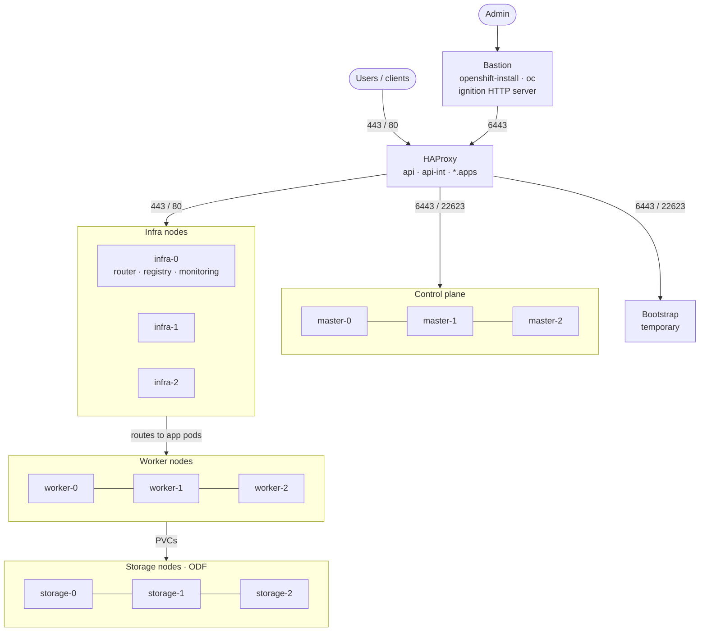

# ARCH-001: OpenShift 4.x UPI reference architecture (15 hosts)

| Field | Value |
|---|---|
| Type | Reference architecture / study record |
| Area | Installation (UPI) · Node roles · Load balancing · Day-2 placement |
| Related Red Hat courses | DO322 (installation), DO280/DO380 (infra nodes, operators) |
| Status | Studied reference design; hands-on rebuild planned (see section 8) |

> **Honesty note:** this is a common enterprise layout that I studied and documented. It is **not** a cluster I operated in production.
> All names, domains and IPs are generic placeholders (`ocp.example.com`, `192.0.2.x`). No employer or customer details.

> **Related:** generic install/bootstrap flow → [OpenShift architecture – Installation and Bootstrap Flow](openshift-architecture.md#-installation-and-bootstrap-flow) · why 3 masters → [etcd quorum explained](etcd-quorum.md). This doc covers one concrete 15-host UPI layout.

---

## 1. Host inventory

| Role | Count | After install | Cluster node? | Purpose |
|---|---|---|---|---|
| Bastion (jump host) | 1 | Stays | No (helper) | Admin entry point; `openshift-install`, `oc`; generates ignition; hosts the ignition HTTP server |
| HAProxy | 1 | Stays | No (helper) | External load balancer for the API, Machine Config Server and app ingress |
| Bootstrap | 1 | **Removed** | No (temporary) | Temporary control plane that brings up the masters |
| Master (control plane) | 3 | Stays | Yes | etcd, kube-apiserver, scheduler, controller-manager |
| Infra | 3 | Stays | Yes | Router, image registry, monitoring, logging |
| Storage | 3 | Stays | Yes | OpenShift Data Foundation (Ceph) storage daemons on local disks |
| Worker | 3 | Stays | Yes | Application workloads |
| **Total** | **15** | **14** | **12** | `oc get nodes` shows **12**, not 14 |

### Why 3 of each

- **Masters:** etcd needs a majority (quorum). 3 members tolerate 1 failure.
- **Infra:** router, registry and monitoring replicas spread across nodes, so losing one node doesn't take ingress down.
- **Storage:** ODF keeps 3 copies of data by default, one per node (ideally one per zone).
- **Workers:** headroom to drain nodes during upgrades without application downtime.

---

## 2. Architecture diagram



---

## 3. DNS records (placeholders)

| Record | Points to | Used by |
|---|---|---|
| `api.ocp.example.com` | HAProxy | `oc` / external API clients |
| `api-int.ocp.example.com` | HAProxy | Nodes talking to the API (internal) |
| `*.apps.ocp.example.com` | HAProxy | All Routes / application traffic |
| `<node>.ocp.example.com` (A + PTR) | Each node | Node hostnames; reverse DNS matters during install |

---

## 4. HAProxy configuration (generic example)

```cfg
# /etc/haproxy/haproxy.cfg (relevant sections only)
frontend api
    bind *:6443
    mode tcp
    default_backend api
backend api
    mode tcp
    balance roundrobin
    option tcp-check
    server bootstrap 192.0.2.10:6443 check   # remove after bootstrap-complete
    server master-0  192.0.2.11:6443 check
    server master-1  192.0.2.12:6443 check
    server master-2  192.0.2.13:6443 check

frontend machine-config
    bind *:22623
    mode tcp
    default_backend machine-config
backend machine-config
    mode tcp
    balance roundrobin
    server bootstrap 192.0.2.10:22623 check  # remove after bootstrap-complete
    server master-0  192.0.2.11:22623 check
    server master-1  192.0.2.12:22623 check
    server master-2  192.0.2.13:22623 check

frontend ingress-https
    bind *:443
    mode tcp
    default_backend ingress-https
backend ingress-https
    mode tcp
    balance source
    server infra-0 192.0.2.21:443 check
    server infra-1 192.0.2.22:443 check
    server infra-2 192.0.2.23:443 check

frontend ingress-http
    bind *:80
    mode tcp
    default_backend ingress-http
backend ingress-http
    mode tcp
    balance source
    server infra-0 192.0.2.21:80 check
    server infra-1 192.0.2.22:80 check
    server infra-2 192.0.2.23:80 check
```

**Note:** until the router is moved to the infra nodes (section 6), the ingress backends must point at whichever nodes run the router pods. On a fresh install, that's the workers.

**Single point of failure:** one HAProxy means one failure takes down the API **and** every Route, even with all 12 nodes healthy. Production uses an HA pair (HAProxy + keepalived VIP) or an enterprise load balancer.

---

## 5. Install flow (UPI)

```text
1. Bastion   : write install-config.yaml (keep a backup: the installer consumes it)
2. Bastion   : openshift-install create manifests  → set masters unschedulable
3. Bastion   : openshift-install create ignition-configs → serve *.ign over HTTP
4. Boot      : bootstrap → masters → workers/infra/storage (RHCOS + ignition URL)
5. Bastion   : openshift-install wait-for bootstrap-complete --log-level=info
6. HAProxy   : remove bootstrap from api + machine-config backends; delete bootstrap host
7. Bastion   : oc get csr ; oc adm certificate approve <csr>   (repeat: client then serving CSRs)
8. Bastion   : oc get nodes ; oc get co   (wait for all ClusterOperators Available)
9. Bastion   : openshift-install wait-for install-complete
```

---

## 6. Day-2: make the infra nodes real

Labelling a node "infra" changes nothing by itself. Each component has to be moved.

```bash
# Label + taint (on UPI, per node; on IPI, use an infra MachineSet instead)
oc label node infra-0 node-role.kubernetes.io/infra=""
oc adm taint node infra-0 node-role.kubernetes.io/infra=reserved:NoSchedule
```

```yaml
# Router: oc edit ingresscontroller default -n openshift-ingress-operator
spec:
  replicas: 3
  nodePlacement:
    nodeSelector:
      matchLabels:
        node-role.kubernetes.io/infra: ""
    tolerations:
    - key: node-role.kubernetes.io/infra
      value: reserved
      effect: NoSchedule
```

```yaml
# Image registry: oc edit configs.imageregistry.operator.openshift.io cluster
spec:
  nodeSelector:
    node-role.kubernetes.io/infra: ""
  tolerations:
  - key: node-role.kubernetes.io/infra
    value: reserved
    effect: NoSchedule
```

```yaml
# Monitoring: ConfigMap cluster-monitoring-config in openshift-monitoring
data:
  config.yaml: |
    prometheusK8s:
      nodeSelector: { node-role.kubernetes.io/infra: "" }
      tolerations:
      - { key: node-role.kubernetes.io/infra, value: reserved, effect: NoSchedule }
    alertmanagerMain:
      nodeSelector: { node-role.kubernetes.io/infra: "" }
      tolerations:
      - { key: node-role.kubernetes.io/infra, value: reserved, effect: NoSchedule }
```

Storage nodes for ODF get the label `cluster.ocs.openshift.io/openshift-storage=""` (and usually the taint `node.ocs.openshift.io/storage=true:NoSchedule`).

**Verify:**

```bash
oc get pods -n openshift-ingress -o wide
oc get pods -n openshift-image-registry -o wide
oc get pods -n openshift-monitoring -o wide | grep -E 'prometheus-k8s|alertmanager'
```

---

## 7. Interview questions this answers

| Question | Short answer |
|---|---|
| Why 3 masters? | etcd quorum: survives 1 failure. 2 masters is worse than 1 for quorum. |
| What runs on infra nodes, and why separate them? | Router, registry, monitoring, logging. Isolation from application load; nodes that run only infra components don't need an OpenShift subscription. |
| What does the bootstrap node do? | Temporary control plane that serves ignition and helps the masters form etcd; removed after `bootstrap-complete`. |
| What does HAProxy balance? | 6443 (API) and 22623 (MCS) → bootstrap + masters; 80/443 → router nodes. |
| 15 hosts built: how many nodes in `oc get nodes`? | 12. Bastion and HAProxy are helpers; bootstrap is gone. |
| Weakest point of this design? | A single HAProxy: an outage takes down the API and all apps. |

---

## 8. Hands-on plan

- [ ] Draw this layout for a real lab cluster and note the differences
- [ ] Read a lab HAProxy config and map frontends to backends
- [ ] Label and taint one node as infra; move the router there; verify with `-o wide`
- [ ] Move the image registry and Prometheus; prove that no application pods land on infra nodes
- [ ] Break-fix: remove the toleration from the IngressController → router pods Pending → write an RCA
