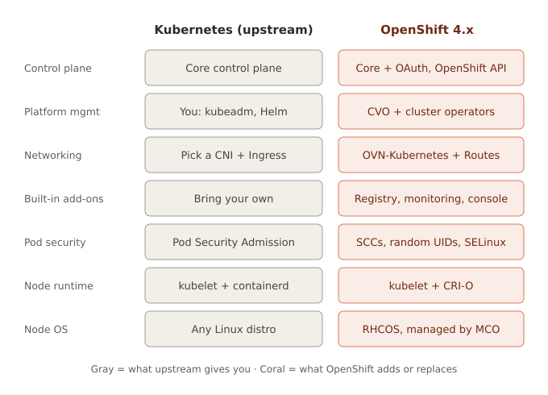

# OpenShift vs Kubernetes Architecture — Interview Prep

Nookireddi Dileep · 18 Nov 2026 · Based on OpenShift 4.x (DO280, OCP 4.18) and upstream Kubernetes / K3s labs

> Concept guide in my own words, written for interview prep. Command reference: [oc command bank](oc-command-bank.md) · [PDF version](pdf/OpenShift-vs-Kubernetes-Architecture.pdf)

> **The one-line answer:** OpenShift is a certified Kubernetes distribution. The core is the same, but OpenShift makes the OS, networking, ingress, registry, monitoring and upgrades part of the platform, all managed by operators, and its security defaults are stricter (SCCs, non-root, SELinux).

---

## 1. The story: a kit vs a finished car

Upstream Kubernetes is an engine kit. You get the engine — API server, etcd, scheduler, controllers, kubelet — and then *you* choose the chassis (OS), the wiring (CNI), the doors (ingress), the dashboard (monitoring), the locks (security policy) and the service plan (upgrades). Every cluster you meet is built a little differently.

OpenShift is the same engine, pre-assembled into one finished car by Red Hat. Every part is chosen, tested together and looked after by a mechanic that never sleeps: **operators**. You lose some freedom of choice; you gain one supported way to install, run, secure and upgrade everything.

So in an interview, never say "OpenShift is different from Kubernetes". Say "OpenShift *is* Kubernetes, plus an opinionated, operator-managed platform around it".

---

## 2. The architecture side by side

---

## 3. Layer by layer

### 3.1 Control plane

| | Kubernetes | OpenShift |
|---|---|---|
| Core components | kube-apiserver, etcd, kube-scheduler, kube-controller-manager | Same four, each run and healed by its own operator |
| Extra API | — | `openshift-apiserver` serves Routes, Projects, BuildConfigs, ImageStreams |
| Extra controllers | — | `openshift-controller-manager` (builds, image triggers, deployments) |
| Authentication | Bring your own (certs, OIDC flags on the API server) | Built-in OAuth server: `oc login` with HTPasswd, LDAP, OIDC — `oc get oauth cluster` |
| etcd | You back it up, rotate certs, manage quorum | `cluster-etcd-operator` manages members and certs; backup with `cluster-backup.sh` |
| Layout | Usually static pods managed by kubelet (kubeadm) | Static pods too, but the operators write and roll the manifests |

The request path for `kubectl apply` / `oc apply` is **identical**: client → API server (authn → authz/RBAC → mutating admission → validating admission) → etcd → controllers and scheduler watch → kubelet → container runtime → runc.

### 3.2 Platform management — "everything is an operator"

This is the single biggest difference.

- **Kubernetes:** you install with kubeadm (or a managed service), add-ons with Helm or manifests, and upgrade each piece yourself, in the right order.
- **OpenShift:** the **Cluster Version Operator (CVO)** owns the whole platform release. It runs ~30 **cluster operators** (`oc get clusteroperators`), each responsible for one component: kube-apiserver, etcd, ingress, dns, network, monitoring, image-registry, machine-config, authentication, console…
- **Upgrades** are one action on an update channel (`stable-4.x`, `fast-4.x`, `eus-4.x`): `oc adm upgrade --to=<version>`. The CVO rolls the components in a fixed order.
- **Troubleshooting habit:** first command on any sick cluster is `oc get co` — look for `AVAILABLE=False`, `PROGRESSING=True` stuck, or `DEGRADED=True`. Then `oc describe co <name>`.
- **Golden rule:** don't hand-edit what an operator owns — it will revert. Change the operator's config resource instead (e.g. `ingresscontroller`, `network.operator`, `config.imageregistry`).

### 3.3 Node OS — RHCOS and the Machine Config Operator

- **Kubernetes:** any Linux distro; you patch and configure nodes with your own tools (SSH, Ansible, Puppet).
- **OpenShift:** control plane nodes **must** run **Red Hat Enterprise Linux CoreOS (RHCOS)**, an image-based, mostly read-only OS; workers normally run it too. The OS version is part of the OpenShift release, so a cluster upgrade also upgrades the OS.
- **Node changes go through the API**, not SSH: create a `MachineConfig` → the **Machine Config Operator (MCO)** renders it for a `MachineConfigPool` (`master`, `worker`, custom pools) → each node is cordoned, drained, updated and rebooted one at a time (`maxUnavailable`).
- **Check:** `oc get mcp` (UPDATED / UPDATING / DEGRADED), `oc get mc`.
- **Getting on a node:** `oc debug node/<name>` then `chroot /host` — then `crictl`, `journalctl -u kubelet`, `journalctl -u crio`.

> **RHEL ops bridge:** think of the MCO as configuration management that the cluster itself owns. Manual edits on a node cause drift and can leave the pool `DEGRADED`.

### 3.4 Container runtime

- **Kubernetes:** any CRI runtime; containerd is the most common.
- **OpenShift:** **CRI-O** only — a lightweight runtime built just for Kubernetes, versioned in lock-step with it. Debugging tool on the node is `crictl` (no `docker` command). See [OCP-006 – CRI-O and the random UID](../stories/OCP-006-exec-without-login.md).

### 3.5 Networking and ingress

| | Kubernetes | OpenShift |
|---|---|---|
| Pod network | You choose a CNI: Calico, Cilium, Flannel… | **OVN-Kubernetes** by default (OpenShiftSDN is gone in recent 4.x releases) |
| Cluster DNS | CoreDNS add-on | CoreDNS run by the DNS operator |
| North-south traffic | Install an Ingress controller (NGINX, Traefik…) and use `Ingress` objects | Built-in **Ingress Operator** runs HAProxy **router** pods; the native object is the **Route** |
| TLS at the edge | Configure per controller | Route TLS types: `edge`, `passthrough`, `re-encrypt` |
| Ingress objects | Native | Still supported — OpenShift converts them into Routes |

**External traffic path in OpenShift:** client → external load balancer / DNS wildcard `*.apps.ocp.example.com` → router pods (usually on infra nodes) → Service → pod.

Quick commands: `oc get route`, `oc expose svc/<name>`, `oc get ingresscontroller -n openshift-ingress-operator`, `oc get pods -n openshift-ingress`.

### 3.6 Security

| | Kubernetes | OpenShift |
|---|---|---|
| Pod-level policy | Pod Security Admission (namespace labels: privileged / baseline / restricted); nothing enforced unless you set it | **Security Context Constraints (SCCs)**; default `restricted-v2` for every pod. OpenShift also runs Pod Security Admission, with labels synced from SCCs |
| User ID | Whatever the image says (often root) | **Random UID** from the namespace's range; root is denied |
| SELinux | Depends on the node OS | Enforcing on every node; each namespace gets its own MCS labels |
| Users and login | External | Built-in OAuth, Users, Groups, `oc login` |
| Default RBAC for tenants | You design it | Project creators get `admin` in their project; `self-provisioner` controls who can create projects |

**Classic interview scenario:** "This image works on Docker / plain Kubernetes but crashes on OpenShift with permission denied." Answer: the image expects to run as root or as a fixed UID and to write to a root-owned folder; OpenShift runs it with a random non-root UID. Fix the image first (group-writable dirs owned by GID 0, listen on a port above 1024). Granting `anyuid` to a dedicated service account (`oc adm policy add-scc-to-user anyuid -z <sa>`) is the last resort, not the first answer. Check which SCC a pod got: annotation `openshift.io/scc` in `oc get pod 
 -o yaml`. Real example from my lab: [RCA-004 – root-only httpd under restricted-v2](../rca/RCA-004-image-tag-and-root-only-httpd.md).

### 3.7 Built-in add-ons

| Area | Kubernetes | OpenShift |
|---|---|---|
| Image registry | External (Harbor, Quay, cloud registry) | Internal registry operator: `image-registry.openshift-image-registry.svc:5000`, plus **ImageStreams** |
| Builds | External CI | **BuildConfig** with Source-to-Image (S2I) or Dockerfile builds |
| Monitoring | Install kube-prometheus-stack yourself | Prometheus, Alertmanager and Thanos Querier pre-wired in `openshift-monitoring`; user workload monitoring is a one-line config switch |
| Logging | Your choice | Logging operator (optional, installed from OperatorHub) |
| Web UI | Optional dashboard | Full web console (admin and developer views) |
| Operators catalog | Install OLM yourself if you want it | **OperatorHub + OLM** built in |
| Node scaling | Cluster Autoscaler per cloud | **Machine API**: `MachineSet` / `Machine` objects, plus `ClusterAutoscaler` and `MachineAutoscaler` |

---

## 4. Node roles and installation

| | Kubernetes | OpenShift |
|---|---|---|
| Node roles | control plane, worker | **control plane** (3 for HA), **worker** (compute), **infra** (router, registry, monitoring — does not count towards subscriptions when it only runs infra workloads), temporary **bootstrap** node during install |
| Install | kubeadm, kops, kubespray, or managed (EKS, GKE, AKS) | **IPI** (installer creates the infrastructure), **UPI** (you build VMs, DNS, LB), **Agent-based** and **Assisted** installers for bare metal / disconnected |
| Tenancy unit | Namespace | **Project** = namespace + request template, default RBAC, quotas |
| CLI | `kubectl` | `oc` — does everything `kubectl` does, plus `login`, `new-project`, `new-app`, `expose`, `debug`, `adm` |
| Support | Community or your vendor | Red Hat: one tested version of every component, release lifecycle and EUS |

---

## 5. kubectl vs oc — the commands that differ

| Task | Kubernetes | OpenShift |
|---|---|---|
| Log in | Edit kubeconfig | `oc login -u <user> https://api.ocp.example.com:6443` |
| Who am I | `kubectl auth whoami` | `oc whoami`, `oc whoami --show-console` |
| New namespace | `kubectl create ns dev` | `oc new-project dev` |
| Expose an app | Write an Ingress | `oc expose svc/web` (creates a Route) |
| Platform health | Check each add-on | `oc get co`, `oc get clusterversion` |
| Node shell | SSH | `oc debug node/<n>` → `chroot /host` |
| Node config | SSH / Ansible | `oc get mcp`, `oc get mc` |
| Upgrade | kubeadm plan/apply per node | `oc adm upgrade`, `oc adm upgrade --to=<v>` |
| Grant a role | `kubectl create rolebinding …` | `oc adm policy add-role-to-user edit <u> -n 
` |
| Debug bundle | Collect by hand | `oc adm must-gather` |

---

## 6. Interview questions with model answers

**Q1. Is OpenShift Kubernetes?**
Yes — it is a CNCF-certified Kubernetes distribution. Every Kubernetes API works. OpenShift adds its own APIs (Routes, Projects, Builds, ImageStreams, SCCs, MachineConfigs) and manages the whole platform with operators.

**Q2. What is the Cluster Version Operator?**
The top-level operator that owns the OpenShift release. It reads the desired version from `ClusterVersion`, then deploys and upgrades all cluster operators in order. If an upgrade is stuck, I check `oc get clusterversion`, then `oc get co` to see which operator is not progressing.

**Q3. Why can't I just SSH to a node and change a file?**
Nodes run RHCOS and are managed by the Machine Config Operator. Manual changes create drift, may be overwritten, and can mark the pool degraded. I make the change as a `MachineConfig`, and the MCO rolls it out node by node with drain and reboot.

**Q4. Route vs Ingress?**
Both expose HTTP(S) apps. Route is OpenShift's native object, served by the HAProxy router, with TLS modes edge, passthrough and re-encrypt. Ingress is the upstream standard; OpenShift supports it by converting it into a Route.

**Q5. Why does a Docker Hub image fail on OpenShift?**
Default SCC `restricted-v2` runs the container with a random non-root UID and no privilege escalation. Images that assume root, a fixed UID or ports below 1024 fail. Fix the image (GID 0 group-writable dirs, high port) before granting `anyuid`.

**Q6. What are infra nodes and why use them?**
Worker nodes labelled and tainted to run platform workloads — router, registry, monitoring. They isolate platform load from apps and, when used only for those workloads, don't consume OpenShift subscriptions.

**Q7. How is an OpenShift upgrade different from a kubeadm upgrade?**
kubeadm: I upgrade the control plane, then each node's kubelet, and every add-on separately. OpenShift: one `oc adm upgrade`; the CVO upgrades the control plane operators, then the MCO updates RHCOS and kubelet on each pool. I still check `oc get co` and `oc get mcp` and respect PodDisruptionBudgets.

**Q8. What does the bootstrap node do?**
A temporary machine during IPI/UPI install that runs a temporary control plane, helps the three masters form etcd and start the real control plane, then is removed.

**Q9. Which runtime does OpenShift use and how do you debug it?**
CRI-O. On the node: `oc debug node/<n>`, `chroot /host`, then `crictl ps -a`, `crictl logs <id>`, `journalctl -u crio`, `journalctl -u kubelet`.

**Q10. When would you pick upstream Kubernetes over OpenShift?**
When the team wants full freedom of components, a lightweight or edge footprint, or a managed cloud service (EKS/GKE/AKS) and has the skills to assemble and support it. OpenShift fits enterprises that want one supported, secure-by-default platform across on-prem and cloud, especially in regulated environments.

---

## 7. Prove it in a lab (break-and-fix)

1. **Same app, two platforms.** Deploy `nginx` (the root-running image) on K3s and on OpenShift. It works on K3s and fails on OpenShift. Find the SCC in the pod annotation, then fix it with `nginxinc/nginx-unprivileged` instead of `anyuid`.
2. **Operator reverts you.** Edit a deployment in `openshift-ingress` by hand (lab cluster only) and watch the Ingress Operator put it back. Then make the same change the right way through the `ingresscontroller` resource.
3. **MachineConfig rollout.** Apply a small `MachineConfig` (e.g. a file under `/etc`) to the worker pool and watch `oc get mcp -w` cordon, drain and reboot nodes one by one.
4. **Route vs Ingress.** Expose one service with `oc expose` and another with an `Ingress`; run `oc get route` and see both. Done in [OCP-016](../stories/OCP-016-ingress-default-controller.md).
5. **Health first.** Before and after every lab, run `oc get co` and `oc get nodes` — make it a reflex.

Do destructive labs only on your own cluster, never on a shared training cluster without permission.

---

## 8. 30-second whiteboard summary

1. Same Kubernetes core and request path.
2. Operators run the platform; the CVO runs the operators.
3. Nodes are RHCOS, configured through MachineConfigs, not SSH.
4. CRI-O runtime, OVN-Kubernetes network, Routes via HAProxy router.
5. Secure by default: SCCs, random non-root UIDs, SELinux enforcing, built-in OAuth.
6. Batteries included: registry, builds, monitoring, console, OperatorHub, Machine API.

*Facts checked against OpenShift 4.x documentation concepts at time of writing; confirm version-specific details (e.g. supported OS for compute nodes) in the docs for the release you are interviewing on.*
